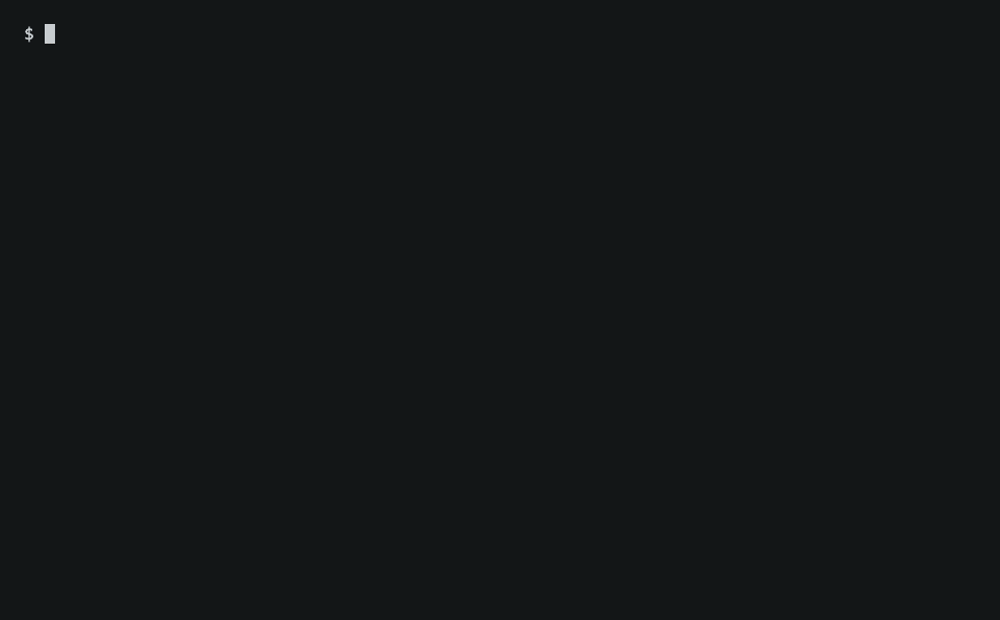

# macchiato

[](https://github.com/MauroCicerchia/macchiato/actions/workflows/ci.yml)
[](https://github.com/MauroCicerchia/macchiato/releases)
[](LICENSE)

Keep your Mac awake with a little coffee.



macchiato is a thin wrapper around macOS's built-in `caffeinate`. It passes every argument through unchanged, so `caffeinate` alone decides how your Mac stays awake. While it runs, macchiato draws a steaming cup of coffee, so you can see at a glance that your Mac is staying awake.

## Install

With [Homebrew](https://brew.sh):

```sh
brew install maurocicerchia/tap/macchiato
```

Or from a clone of this repository, into `~/.local` (set `PREFIX` to choose another location):

```sh
make install
```

Make sure the `bin` directory under your `PREFIX` is on your `PATH`.

## Usage

```sh
macchiato                 # stay awake until Ctrl+C
macchiato -t 3600         # stay awake for one hour
macchiato -d -t 1800      # keep the display awake for 30 minutes
macchiato -w 12345        # stay awake until process 12345 exits
macchiato -i make         # stay awake while make runs (no cup; make keeps the terminal)
```

All options belong to `caffeinate`; see `man caffeinate`. `macchiato --help` gives a summary, and `macchiato --version` prints the version. Both work only as the single argument, so they never collide with what you pass to `caffeinate`.

`Ctrl+C` stops `caffeinate` and erases the cup. `Ctrl+Z` erases it while suspended, and `fg` brings it back. macchiato exits with `caffeinate`'s status. When interrupted, it exits from the same signal, so loops and scripts stop as they would with `caffeinate` alone.

## When the cup is drawn

The cup is drawn on standard error, sized to fit the window, and redrawn when the window is resized. Typed input is not echoed while it is drawn. In a small window, only the status text is shown.

macchiato draws nothing and hands the process over to `caffeinate` when:

- standard error is not a terminal, for example when it is redirected to a file;
- `TERM` is unset or `dumb`;
- `MACCHIATO_NO_ANIMATION` is set;
- `caffeinate` runs a utility, as in `macchiato -i make`. The utility keeps its input, output, and signals.

### Colors

| Environment | Result |
| --- | --- |
| `COLORTERM=truecolor` or `24bit` | 24-bit colors, as in the demo |
| anything else | the closest 256-color palette |
| `NO_COLOR` set | status text only, without colors or cup ([no-color.org](https://no-color.org)) |

Most modern terminals that support 24-bit color set `COLORTERM` for you, including iTerm2, Ghostty, kitty, WezTerm, and the VS Code terminal. If yours supports it but doesn't set it, add `export COLORTERM=truecolor` to your shell startup file.

## Requirements

macOS, with its built-in `caffeinate` and `/bin/bash`. There are no other runtime dependencies.

## Uninstall

```sh
brew uninstall macchiato     # Homebrew
make uninstall               # make install; use the same PREFIX
```

## Contributing

Bug reports, ideas, and pull requests are welcome. See [CONTRIBUTING.md](CONTRIBUTING.md) for the development setup and release process.

## License

[MIT](LICENSE)
